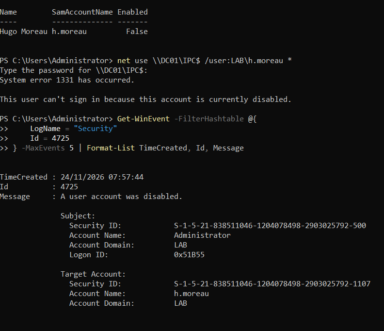
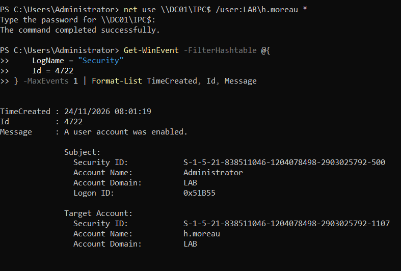

# INC-001 — Compte utilisateur désactivé

## 1. Informations générales

| Paramètre | Valeur |
|---|---|
| Référence | INC-001 |
| Date | 24/11/2026 |
| Catégorie | Active Directory / Authentification |
| Niveau de support | N1 |
| Utilisateur | Hugo Moreau |
| Identifiant | h.moreau |
| Service | Comptabilité |
| Statut | Résolu |

---

## 2. Description de l'incident

L'utilisateur signale qu'il ne parvient plus à s'authentifier avec son compte Active Directory malgré l'utilisation de son mot de passe habituel.

L'incident empêche l'utilisateur d'accéder aux ressources réseau nécessitant une authentification auprès du domaine LAB.local.

---

## 3. Environnement technique

- Windows Server 2022.
- Contrôleur de domaine DC01.
- Domaine Active Directory LAB.local.
- Windows PowerShell.
- Journal de sécurité Windows.

---

## 4. Simulation de l'incident

Afin de reproduire le problème, le compte utilisateur a volontairement été désactivé depuis le contrôleur de domaine.

```powershell
Disable-ADAccount -Identity "h.moreau"
```

Cette opération empêche l'utilisateur de s'authentifier sans supprimer son compte Active Directory.

---

## 5. Diagnostic

### 5.1. Vérification de l'état du compte

La commande suivante permet de vérifier si le compte utilisateur est actif :

```powershell
Get-ADUser -Identity "h.moreau" |
Select-Object Name, SamAccountName, Enabled
```

Résultat obtenu :

```text
Name         SamAccountName Enabled
----         -------------- -------
Hugo Moreau  h.moreau       False
```

La propriété Enabled indique que le compte est désactivé.

### 5.2. Vérification de l'authentification

Une tentative d'authentification a été réalisée avec le compte utilisateur et son mot de passe correct.

```powershell
net use \\DC01\IPC$ /user:LAB\h.moreau *
```

Résultat obtenu :

```text
System error 1331 has occurred.

This user can't sign in because this account is currently disabled.
```

L'erreur système 1331 confirme que la désactivation du compte empêche l'authentification.

### 5.3. Analyse du journal de sécurité Windows

Une recherche de l'événement 4725 a été effectuée dans le journal de sécurité du contrôleur de domaine.

```powershell
Get-WinEvent -FilterHashtable @{
    LogName = "Security"
    Id = 4725
} -MaxEvents 5 | Format-List TimeCreated, Id, Message
```

Informations relevées :

| Information | Résultat |
|---|---|
| Event ID | 4725 |
| Description | A user account was disabled |
| Date | 24/11/2026 |
| Heure | 07:57:44 |
| Auteur de l'action | LAB\Administrator |
| Compte concerné | LAB\h.moreau |

L'analyse du journal permet de confirmer la désactivation du compte, d'identifier le compte administrateur à l'origine de l'opération et de déterminer la date de celle-ci.



---

## 6. Cause racine

Le compte Active Directory de Hugo Moreau était désactivé.

L'échec d'authentification n'était donc pas lié à un mot de passe incorrect, à un verrouillage du compte ou à un problème de permissions réseau.

---

## 7. Résolution

Dans un environnement professionnel, une vérification préalable auprès des personnes habilitées serait nécessaire afin de s'assurer que la désactivation du compte n'est pas volontaire ou liée à un incident de sécurité.

Dans le cadre du laboratoire, le compte a été réactivé avec PowerShell.

```powershell
Enable-ADAccount -Identity "h.moreau"
```

Aucune réinitialisation du mot de passe n'a été nécessaire.

---

## 8. Validation de la résolution

### 8.1. Vérification de l'état du compte

```powershell
Get-ADUser -Identity "h.moreau" |
Select-Object Name, SamAccountName, Enabled
```

Résultat :

```text
Name         SamAccountName Enabled
----         -------------- -------
Hugo Moreau  h.moreau       True
```

Le compte est de nouveau actif.

### 8.2. Test d'authentification

Une nouvelle tentative d'authentification a été réalisée.

```powershell
net use \\DC01\IPC$ /user:LAB\h.moreau *
```

L'authentification a réussi, confirmant la résolution de l'incident.

### 8.3. Vérification de l'événement de réactivation

```powershell
Get-WinEvent -FilterHashtable @{
    LogName = "Security"
    Id = 4722
} -MaxEvents 1 | Format-List TimeCreated, Id, Message
```

L'événement 4722 confirme la réactivation du compte utilisateur.


Informations relevées :

| Information | Résultat |
|---|---|
| Event ID | 4722 |
| Description | A user account was enabled |
| Date | 24/11/2026 |
| Heure | 08:01:19 |
| Auteur de l'action | LAB\Administrator |
| Compte concerné | LAB\h.moreau |

L'événement 4722 et la réussite du test d'authentification confirment la résolution de l'incident.



---

## 9. Compétences mobilisées

- Administration des comptes Active Directory.
- Diagnostic des problèmes d'authentification.
- Identification d'un compte désactivé.
- Interprétation des erreurs système Windows.
- Analyse des journaux de sécurité.
- Identification des événements Windows 4725 et 4722.
- Administration Active Directory avec PowerShell.
- Validation d'une intervention technique.
- Documentation d'un incident de support informatique.

---

## 10. Bonnes pratiques

- Vérifier l'état du compte avant de réinitialiser un mot de passe.
- Distinguer un compte désactivé d'un compte verrouillé.
- Identifier l'origine de la désactivation dans les journaux de sécurité.
- Obtenir les autorisations nécessaires avant de réactiver un compte.
- Vérifier le rétablissement de l'authentification après intervention.
- Documenter les actions réalisées dans le ticket de support.

---

## 11. Conclusion

L'incident a été diagnostiqué et résolu sans modification du mot de passe utilisateur.

La consultation des propriétés Active Directory et des journaux de sécurité Windows a permis d'identifier la cause du problème, de réactiver le compte et de valider le rétablissement de l'authentification.

**Statut final : Résolu.**

---

[Retour à la liste des incidents](README.md)

[Retour au README principal](../../README.md)
