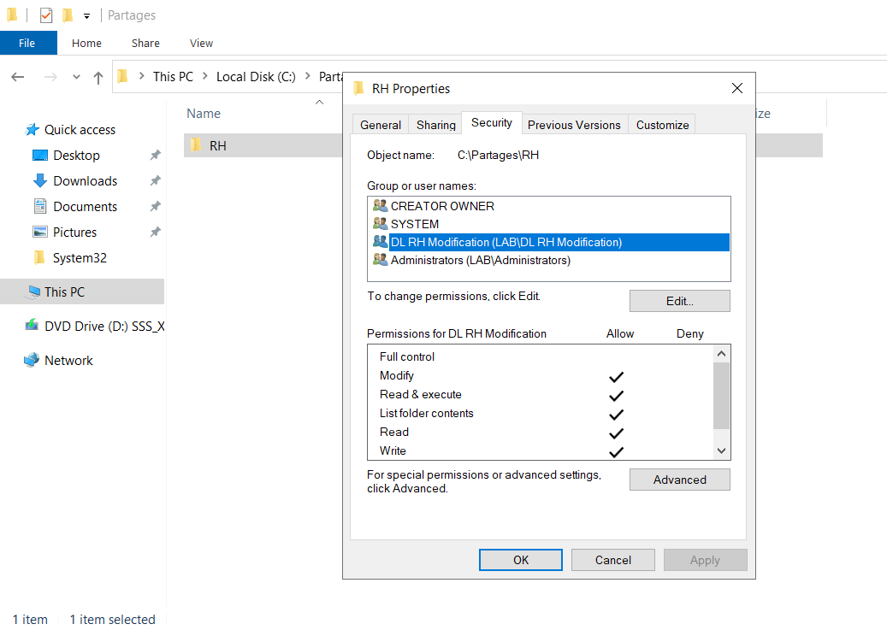

# INC-004 — Impossible de modifier les fichiers d'un dossier partagé (NTFS)

**Statut : Résolu — Clôturé**

**Catégorie : Support informatique / Windows Server / Permissions NTFS**

**Priorité : P3 — Moyenne (simulation)**

**Environnement : Windows Server 2022 / Active Directory / SMB**

---

## 1. Description de l'incident

**Utilisatrice concernée :** Julie Durand

**Service :** Ressources humaines

**Compte Active Directory :** `LAB\j.durand`

**Domaine :** `LAB.local`

**Serveur de fichiers :** `DC01`

**Ressource concernée :** `\\DC01\RH`

### Problème signalé

L'utilisatrice contacte le support informatique car elle peut consulter les documents du service RH, mais ne parvient plus à créer ou modifier des fichiers.

Lorsqu'elle tente d'enregistrer un nouveau document, Windows lui refuse l'accès.

**Impact :** impossibilité de créer et modifier les documents du service RH, malgré un accès en lecture fonctionnel.

**Objectif de l'intervention :** identifier l'origine du refus d'écriture, rétablir les permissions nécessaires et vérifier le retour à la normale.

---

## 2. Environnement technique

| Composant | Configuration |
| --- | --- |
| Système d'exploitation | Windows Server 2022 |
| Contrôleur de domaine | DC01 |
| Domaine | LAB.local |
| Adresse IP | 192.168.31.10 |
| Dossier physique | `C:\Partages\RH` |
| Partage réseau | `\\DC01\RH` |
| Groupe de sécurité | `LAB\DL RH Modification` |
| Permission SMB | Change |
| Permission NTFS initiale | Modify |
| Permission NTFS après modification | ReadAndExecute |

L'accès au dossier RH est administré par un groupe de sécurité Active Directory.

Les comptes Julie Durand et Emma Petit sont membres du groupe `DL RH Modification`.

Les permissions SMB et NTFS sont configurées séparément. Pour un accès réseau, les deux niveaux d'autorisation sont pris en compte.

---

## 3. Vérification de la configuration initiale

Avant de reproduire l'incident, les autorisations du partage ont été contrôlées.

### Vérification des permissions SMB

```
Get-SmbShareAccess -Name "RH"
```

**Résultat :**

```
AccountName                AccessControlType  AccessRight
-----------                -----------------  -----------
LAB\DL RH Modification     Allow              Change
```

### Vérification des permissions NTFS

```
(Get-Acl "C:\Partages\RH").Access |
Format-Table IdentityReference, FileSystemRights, AccessControlType, IsInherited -AutoSize
```

**Résultat :**

```
IdentityReference          FileSystemRights       AccessControlType  IsInherited
-----------------          ----------------       -----------------  -----------
CREATOR OWNER              FullControl            Allow              False
NT AUTHORITY\SYSTEM        FullControl            Allow              False
BUILTIN\Administrators     FullControl            Allow              False
LAB\DL RH Modification     Modify, Synchronize    Allow              False
```

La configuration initiale autorisait donc les membres du groupe RH à consulter et modifier les fichiers.

---

## 4. Reproduction de l'incident

Afin de simuler une erreur d'administration, les permissions NTFS du groupe `DL RH Modification` ont été volontairement réduites.

### Sauvegarde des autorisations

```
icacls "C:\Partages\RH" /save "C:\RH-ACL-Backup.txt"
```

**Résultat :**

```
Successfully processed 1 files; Failed processing 0 files
```

Cette sauvegarde permet de conserver les ACL initiales avant modification.

### Modification des permissions NTFS

```
icacls "C:\Partages\RH" /grant:r "LAB\DL RH Modification:(OI)(CI)RX"
```

Explication des paramètres :

| Paramètre | Signification |
| --- | --- |
| `/grant:r` | Remplacement des autorisations explicites du groupe |
| `(OI)` | Héritage des autorisations par les fichiers |
| `(CI)` | Héritage des autorisations par les sous-dossiers |
| `RX` | Read & Execute : lecture et exécution |

Cette manipulation a remplacé l'autorisation NTFS `Modify` par `ReadAndExecute`.

Les permissions SMB et les appartenances aux groupes AD sont restées inchangées.

### Vérification après modification

```
(Get-Acl "C:\Partages\RH").Access |
Format-Table IdentityReference, FileSystemRights, AccessControlType, IsInherited -AutoSize
```

**Résultat observé pour le groupe RH :**

```
LAB\DL RH Modification  ReadAndExecute, Synchronize  Allow  False
```

---

## 5. Tests fonctionnels — Reproduction du problème

Les tests ont été effectués depuis `DC01`, en utilisant une connexion SMB avec les identifiants de Julie Durand.

### Connexion au partage

```
net use R: \\DC01\RH /user:LAB\j.durand *
```

**Résultat :**

```
The command completed successfully.
```

L'authentification réseau a réussi.

### Test de lecture

```
dir R:\
```

**Résultat :** affichage du contenu du dossier, notamment :

```
INC-005-Test.txt
Test-Julie.txt
```

Julie pouvait donc toujours consulter les fichiers.

### Test de création d'un fichier

```
"Test incident INC-004" | Set-Content R:\INC-004-Test.txt
```

**Erreur observée :**

```
Set-Content : Access to the path 'R:\INC-004-Test.txt' is denied.
```

PowerShell a également retourné une exception de type :

```
UnauthorizedAccessException
```

### Conclusion des tests

| Opération | Résultat |
| --- | --- |
| Authentification SMB | Réussie |
| Consultation du dossier | Réussie |
| Création d'un fichier | Refusée |

L'incident a été reproduit avec succès.

---

## 6. Diagnostic et identification de la cause

### Vérification de l'appartenance au groupe AD

```
Get-ADGroupMember -Identity "DL RH Modification" |
Select-Object Name, SamAccountName
```

La présence de Julie Durand dans le groupe a été confirmée.

L'hypothèse d'une perte d'appartenance au groupe AD a donc été écartée.

### Vérification des permissions NTFS

```
(Get-Acl "C:\Partages\RH").Access |
Where-Object {
    $_.IdentityReference -eq "LAB\DL RH Modification"
} |
Select-Object IdentityReference, FileSystemRights, AccessControlType
```

**Résultat :**

```
IdentityReference         FileSystemRights           AccessControlType
-----------------         ----------------           -----------------
LAB\DL RH Modification    ReadAndExecute, Synchronize Allow
```

Le groupe RH possédait uniquement les droits de lecture et d'exécution.

### Cause racine identifiée

**Modification incorrecte des permissions NTFS du dossier RH, entraînant la suppression du droit d'écriture pour le groupe `DL RH Modification`.**

Les permissions SMB étaient toujours configurées sur `Change`, mais les autorisations NTFS limitaient les opérations possibles.

La lecture restait autorisée, tandis que la création de fichiers était refusée.

Aucune anomalie d'authentification ou d'appartenance au groupe Active Directory n'a été constatée.

---

## 7. Résolution appliquée

La correction a consisté à rétablir l'autorisation NTFS `Modify` pour le groupe de sécurité RH.

### Commande PowerShell

```
icacls "C:\Partages\RH" /grant:r "LAB\DL RH Modification:(OI)(CI)M"
```

Le paramètre `M` correspond à l'autorisation *Modify*, qui comprend notamment les droits de lecture, d'écriture, de modification et de suppression.

### Vérification des permissions

```
(Get-Acl "C:\Partages\RH").Access |
Where-Object {
    $_.IdentityReference -eq "LAB\DL RH Modification"
} |
Select-Object IdentityReference, FileSystemRights, AccessControlType
```

**Configuration attendue après correction :**

```
LAB\DL RH Modification  Modify, Synchronize  Allow
```

Les droits du groupe ont été restaurés sans modifier les permissions SMB ni les appartenances Active Directory.

---

## 8. Validation de la résolution

Une fois les autorisations NTFS rétablies, de nouveaux tests ont été effectués avec le compte de Julie.

### Test de création

```
"INC-004 : permissions NTFS restaurees" |
Set-Content R:\INC-004-Test.txt
```

**Résultat :** création du fichier réussie.

### Test de lecture

```
Get-Content R:\INC-004-Test.txt
```

**Résultat :** contenu du fichier affiché correctement.

### Test de modification

```
"Test de modification reussi" |
Add-Content R:\INC-004-Test.txt
```

### Vérification finale

```
Get-Content R:\INC-004-Test.txt
```

Les deux lignes ont été retrouvées dans le fichier.

### Synthèse des vérifications

| Vérification | Résultat |
| --- | --- |
| Connexion SMB | Réussie |
| Lecture du dossier RH | Réussie |
| Création d'un fichier | Réussie |
| Lecture du fichier créé | Réussie |
| Modification du fichier | Réussie |
| Restauration des permissions NTFS | Réussie |

**Résultat final :** Julie Durand peut de nouveau créer, consulter et modifier les fichiers du dossier RH.

---
### Vérification des permissions NTFS

Autorisations NTFS après restauration du droit de modification pour le groupe DL RH Modification.



## 9. Différence avec INC-005

Cet incident complète un autre scénario réalisé dans le laboratoire : **INC-005 — Accès refusé à un dossier partagé RH**.

| Élément | INC-004 | INC-005 |
| --- | --- | --- |
| Problème | Écriture refusée | Accès refusé |
| Appartenance au groupe AD | Conservée | Supprimée |
| Permissions SMB | Change | Change |
| Permissions NTFS | ReadAndExecute | Modify |
| Cause | Permissions NTFS insuffisantes | Groupe AD manquant |
| Résolution | Restaurer Modify | Réintégrer l'utilisateur au groupe |

Ces deux exercices illustrent deux causes distinctes de problèmes d'accès à un dossier partagé Windows.

---

## 10. Bonnes pratiques professionnelles

- Vérifier les droits existants avant toute modification.
- Sauvegarder les ACL avant une intervention sur les permissions.
- Contrôler séparément les permissions SMB et NTFS.
- Vérifier les appartenances aux groupes Active Directory.
- Éviter d'attribuer directement des permissions à un utilisateur lorsque des groupes de sécurité sont prévus.
- Respecter le principe du moindre privilège.
- Réaliser des tests de lecture et d'écriture après correction.
- Documenter les commandes utilisées et les résultats observés.

**Point de vigilance :** une modification des permissions sur un dossier parent ne garantit pas que toutes les ACL explicites des fichiers et sous-dossiers existants seront remplacées. Les droits effectifs doivent être vérifiés sur les ressources concernées.

---

## 11. Compétences mobilisées

### Windows Server et NTFS

- Gestion des autorisations NTFS.
- Compréhension des droits `ReadAndExecute` et `Modify`.
- Gestion des ACL et des règles d'héritage.
- Sauvegarde et modification des permissions avec `icacls`.

### Active Directory

- Vérification des appartenances aux groupes.
- Gestion des autorisations par groupes de sécurité.
- Compréhension du contrôle d'accès aux ressources.

### Réseau et SMB

- Connexion à un partage réseau.
- Différenciation entre authentification et autorisation.
- Compréhension de l'interaction entre permissions SMB et NTFS.

### PowerShell

- `Get-Acl`
- `Get-SmbShareAccess`
- `Get-ADGroupMember`
- `Set-Content`
- `Get-Content`
- `Add-Content`
- `icacls`
- `net use`

### Support informatique N1

- Reproduction d'un incident utilisateur.
- Diagnostic des problèmes d'accès aux fichiers.
- Identification de la cause racine.
- Application d'une correction ciblée.
- Validation fonctionnelle.
- Documentation et clôture d'un ticket.

---

## 12. Conclusion

Cet exercice a permis de reproduire et résoudre un incident d'autorisation NTFS sur un dossier partagé Windows Server.

L'utilisatrice pouvait accéder au partage et consulter les fichiers, mais ne disposait plus des droits nécessaires pour en créer ou modifier.

Le diagnostic a permis de confirmer que le compte Active Directory et son appartenance au groupe étaient corrects, puis d'identifier une autorisation NTFS insuffisante.

Après restauration du droit `Modify`, les tests de création, lecture et modification ont confirmé le rétablissement de l'accès.

**Ticket INC-004 résolu et clôturé.**

---

*Incident fictif réalisé dans un laboratoire Active Directory sous Windows Server 2022, à des fins de formation et de démonstration de compétences en support informatique.*
