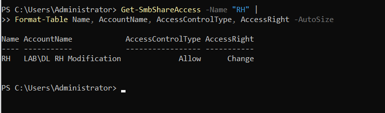

# INC-005 — Accès refusé à un dossier partagé RH

**Statut : Résolu — Clôturé**

**Date de résolution : 6 novembre 2026**

**Catégorie : Support informatique / Active Directory / Permissions SMB-NTFS**

**Priorité : P3 — Moyenne (simulation)**

**Environnement : Windows Server 2022 / Active Directory**

---

## 1. Description de l'incident

**Utilisateur concerné :** Julie Durand

**Service :** Ressources humaines

**Identifiant Active Directory :** `LAB\j.durand`

**Serveur :** `DC01`

**Ressource concernée :** `\\DC01\RH`

### Problème signalé

L'utilisatrice indique ne plus pouvoir accéder au dossier partagé du service RH, alors que celui-ci était auparavant accessible.

Lors de la tentative d'ouverture du dossier, Windows affiche le message :

```
Access is denied.
```

**Impact :** impossibilité de consulter et modifier les documents du service RH.

**Périmètre :** incident limité au compte de Julie Durand dans le scénario de laboratoire.

## . Environnement technique

| Composant | Configuration |
| --- | --- |
| Contrôleur de domaine | DC01 |
| Système | Windows Server 2022 |
| Domaine | LAB.local |
| Adresse IP du serveur | 192.168.31.10 |
| Dossier physique | `C:\Partages\RH` |
| Partage SMB | `\\DC01\RH` |
| Groupe de sécurité | `DL RH Modification` |
| Permission SMB | Change |
| Permission NTFS | Modify |

L'accès au dossier RH est géré par un groupe de sécurité Active Directory de portée *Domain Local*.

Les utilisateurs autorisés sont normalement Julie Durand et Emma Petit.

## 3. Reproduction de l'incident

Pour simuler une erreur d'administration, le compte `j.durand` a volontairement été retiré du groupe `DL RH Modification`.

Après renouvellement de la connexion SMB, une tentative d'accès au dossier a été effectuée.

### Connexion réseau

```
net use R: \\DC01\RH /user:LAB\j.durand *
```

### Vérification de l'accès

```
dir R:\
```

**Résultat observé :**

```
Access is denied.
```

Le dysfonctionnement a ainsi été reproduit.

## 4. Diagnostic réalisé

### Vérification de l'état du compte

```
Get-ADUser -Identity "j.durand" -Properties Enabled |
Select-Object Name, Enabled
```

Objectif : vérifier que le compte existe et qu'il est actif.

La vérification du compte a été réalisée avant la correction.

### Vérification des groupes Active Directory

```
Get-ADPrincipalGroupMembership -Identity "j.durand" |
Select-Object Name
```

Objectif : identifier les groupes auxquels appartient l'utilisatrice.

L'investigation a porté sur l'absence du groupe `DL RH Modification`, nécessaire pour accéder au partage RH.

### Vérification du modèle d'autorisation

Le dossier RH était déjà configuré avec les permissions suivantes :

| Niveau | Groupe | Autorisation |
| --- | --- | --- |
| SMB | DL RH Modification | Change |
| NTFS | DL RH Modification | Modify |

Les autorisations générales `Users` avaient précédemment été supprimées des ACL NTFS du dossier.

La configuration du partage ne nécessitait donc aucune modification supplémentaire.

### Vérification des permissions SMB

Vérification des autorisations du partage RH avec la commande PowerShell Get-SmbShareAccess.



## 5. Cause racine identifiée

**Suppression du compte Julie Durand du groupe de sécurité `DL RH Modification`.**

Le compte utilisateur était privé de l'appartenance au groupe donnant accès au dossier partagé.

Le refus d'accès était donc lié à une modification des appartenances Active Directory, et non à une panne du serveur ou du service SMB.

Cette cause a été introduite volontairement dans le cadre du laboratoire.

## 6. Résolution appliquée

La correction a consisté à réintégrer l'utilisatrice dans son groupe de sécurité d'origine.

### Commande PowerShell

```
Add-ADGroupMember -Identity "DL RH Modification" -Members "j.durand"
```

### Vérification de l'appartenance

```
Get-ADGroupMember -Identity "DL RH Modification" |
Select-Object Name, SamAccountName
```

**Résultat attendu et confirmé :**

- Julie Durand (`j.durand`)
- Emma Petit (`e.petit`)

Aucune modification des permissions SMB ou NTFS n'a été nécessaire.

## 7. Validation de la résolution

Après correction, la connexion SMB a été renouvelée afin de prendre en compte les droits de l'utilisatrice.

### Suppression de l'ancienne connexion

```
net use R: /delete
```

### Nouvelle authentification

```
net use R: \\DC01\RH /user:LAB\j.durand *
```

### Tests fonctionnels

**Test 1 — Consultation du dossier**

```
dir R:\
```

**Test 2 — Création d'un fichier**

```
"Incident INC-005 résolu" | Set-Content R:\INC-005-Test.txt
```

**Test 3 — Lecture du fichier**

```
Get-Content R:\INC-005-Test.txt
```

### Résultats

| Vérification | Résultat |
| --- | --- |
| Réintégration dans le groupe AD | Réussie |
| Connexion SMB | Réussie |
| Consultation du dossier RH | Réussie |
| Création d'un fichier | Réussie |
| Lecture du fichier | Réussie |

**Résultat final :** Julie Durand a retrouvé l'accès au dossier partagé RH et peut à nouveau consulter et modifier les fichiers.

## 8. Synthèse de l'intervention

| Élément | Conclusion |
| --- | --- |
| Symptôme | Accès refusé au partage RH |
| Cause | Appartenance au groupe AD supprimée |
| Diagnostic | Vérification du compte et des groupes AD |
| Correction | Réintégration dans `DL RH Modification` |
| Vérification | Tests SMB de lecture et d'écriture |
| Statut final | Résolu — Clôturé |

### Bonnes pratiques appliquées

- Vérification du compte utilisateur avant toute modification.
- Diagnostic des appartenances aux groupes Active Directory.
- Correction de la cause plutôt que modification directe des permissions du dossier.
- Application du principe du moindre privilège.
- Validation fonctionnelle après intervention.
- Documentation des commandes et des résultats.

## 9. Compétences mobilisées

**Active Directory**

- Gestion des comptes utilisateurs.
- Consultation et modification des appartenances aux groupes.
- Administration des groupes de sécurité.

**Windows Server / Réseau**

- Utilisation des partages SMB.
- Compréhension des permissions NTFS et SMB.
- Renouvellement des connexions réseau.

**Support informatique N1**

- Qualification et reproduction d'un incident.
- Diagnostic méthodique.
- Identification de la cause racine.
- Application d'une correction ciblée.
- Tests de non-régression fonctionnelle.
- Documentation et clôture d'un ticket.

## 10. Conclusion

Cet exercice a permis de simuler un incident courant de support informatique : la perte d'accès à un dossier partagé à la suite d'une modification des groupes de sécurité Active Directory.

Le diagnostic a permis d'identifier la cause sans modifier inutilement les permissions du dossier.

Après réintégration de l'utilisatrice dans le groupe approprié, les tests de connexion, de lecture et d'écriture ont confirmé le rétablissement du service.

**Ticket INC-005 clôturé avec succès.**

---

*Environnement fictif réalisé à des fins d'apprentissage et de démonstration des compétences en support informatique et administration Windows Server.*
