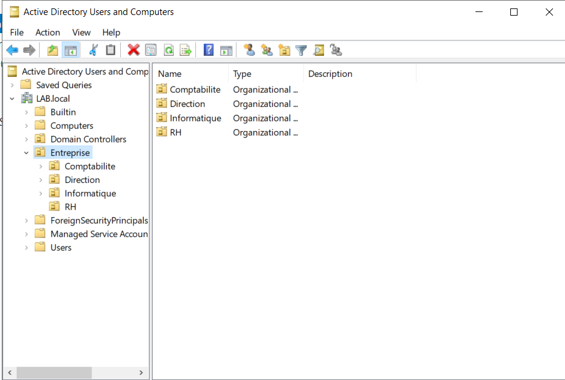
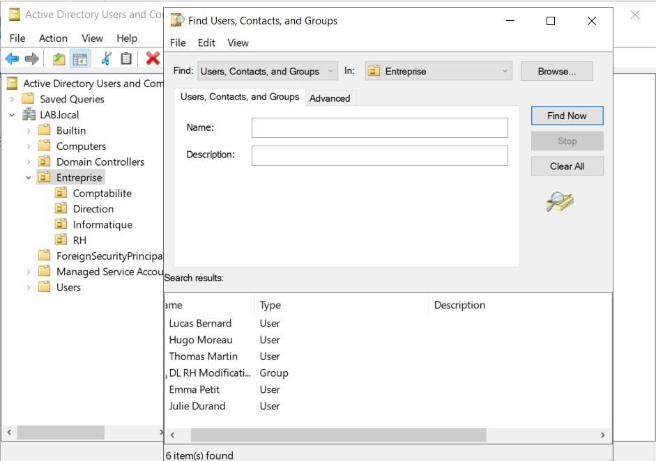
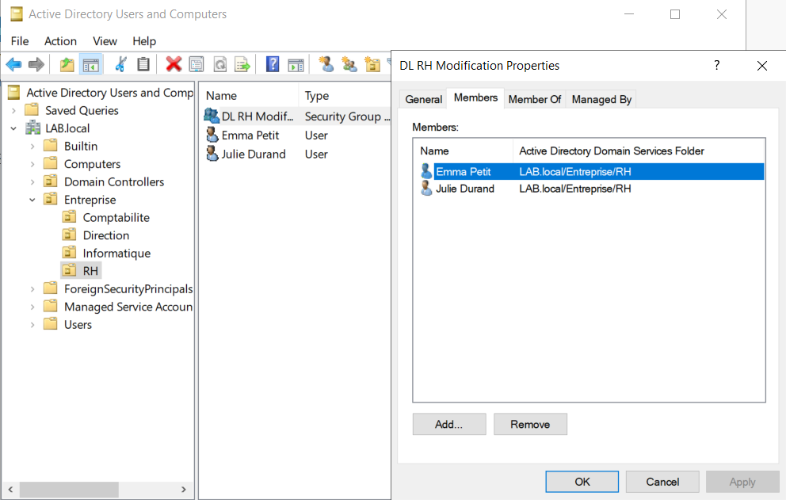
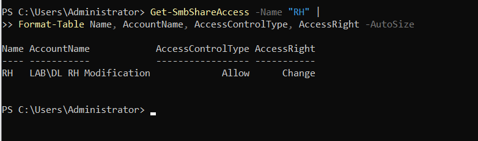
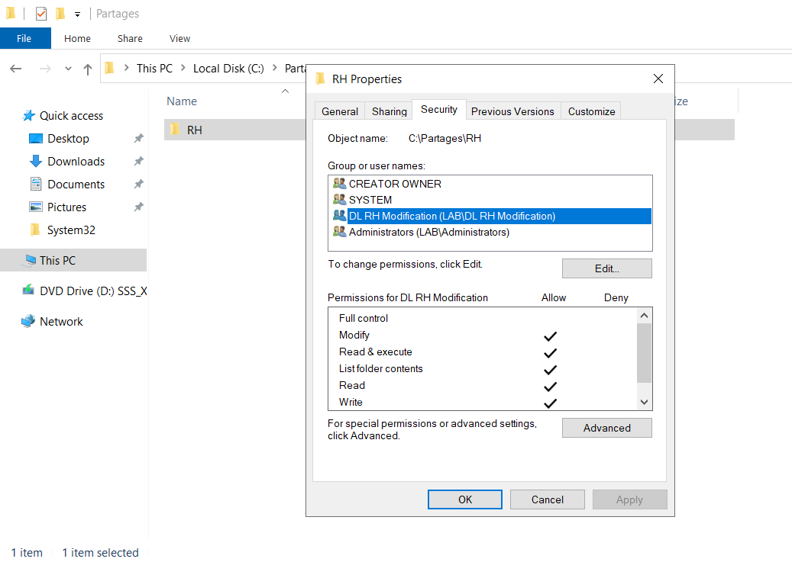
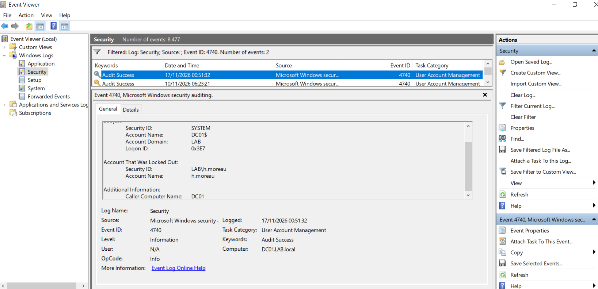

# Documentation technique — Active Directory Helpdesk Lab

## 1. Objectif du laboratoire

Ce laboratoire reproduit un environnement informatique d'entreprise simplifié afin de développer des compétences en administration Active Directory et en support informatique de niveau 1.

Il permet notamment de pratiquer :

- L'administration des comptes utilisateurs.
- La gestion des unités d'organisation (OU).
- La gestion des groupes de sécurité.
- La configuration des partages réseau.
- La gestion des permissions SMB et NTFS.
- Le diagnostic et la résolution d'incidents.
- L'analyse des journaux d'événements Windows.
- L'administration avec PowerShell.

---

## 2. Environnement de virtualisation

| Paramètre | Configuration |
|---|---|
| Hyperviseur | VMware Workstation |
| Machine virtuelle | DC01-V2 |
| Système d'exploitation | Windows Server 2022 Standard Evaluation |
| Interface | Desktop Experience |
| Nom du serveur | DC01 |
| Mémoire vive | 3 Go |
| Processeurs virtuels | 2 vCPU |
| Stockage | 60 Go |
| Mode réseau | NAT (VMnet8) |
| VMware Tools | Installé |

---

## 3. Configuration réseau

Le contrôleur de domaine dispose d'une adresse IP statique afin de garantir la disponibilité des services Active Directory et DNS.

| Paramètre | Valeur |
|---|---|
| Réseau | 192.168.31.0/24 |
| Adresse IP du serveur | 192.168.31.10 |
| Masque de sous-réseau | 255.255.255.0 |
| Passerelle par défaut | 192.168.31.2 |
| Serveur DNS | 192.168.31.10 |
| Nom d'hôte | DC01 |
| FQDN | DC01.LAB.local |

### Architecture réseau

```text
Machine physique
       |
VMware Workstation
       |
Réseau NAT - VMnet8
192.168.31.0/24
       |
       +-- Passerelle : 192.168.31.2
       |
       +-- DC01 : 192.168.31.10
           |
           +-- Active Directory
           +-- DNS
           +-- Partage SMB
```

### Commandes de vérification

```powershell
Get-NetIPConfiguration
Get-NetIPAddress -AddressFamily IPv4
Get-DnsClientServerAddress
```

---

## 4. Configuration Active Directory

Les rôles Active Directory Domain Services (AD DS) et DNS ont été installés sur le serveur.

Le serveur a ensuite été promu en contrôleur de domaine au sein d'une nouvelle forêt Active Directory.

| Paramètre | Valeur |
|---|---|
| Nom du domaine | LAB.local |
| Nom NetBIOS | LAB |
| Nom de la forêt | LAB.local |
| Contrôleur de domaine | DC01 |
| Rôle AD DS | Installé |
| Rôle DNS | Installé |

### Vérification du domaine

```powershell
Get-ADDomain
Get-ADForest
Get-ADDomainController
dcdiag
```

---

## 5. Configuration DNS

Le serveur DC01 assure également la résolution DNS du domaine LAB.local.

La configuration comprend :

- Une zone de recherche directe.
- Une zone de recherche inversée.
- La résolution du nom du contrôleur de domaine.
- La résolution inverse de son adresse IP.

### Commandes de vérification

```powershell
Get-DnsServerZone
Resolve-DnsName DC01.LAB.local
Resolve-DnsName 192.168.31.10
```

Le fonctionnement du DNS est essentiel pour la localisation des services Active Directory et l'authentification au sein du domaine.

---

## 6. Organisation des unités d'organisation

Une unité d'organisation principale nommée Entreprise a été créée afin de reproduire la structure interne d'une entreprise.

```text
LAB.local
└── Entreprise
    ├── Comptabilite
    ├── Direction
    ├── Informatique
    └── RH
```

Cette organisation permet de répartir les utilisateurs selon leur service et de préparer une éventuelle application de stratégies de groupe (GPO).



### Vérification des OU

```powershell
Get-ADOrganizationalUnit -Filter * `
-SearchBase "OU=Entreprise,DC=LAB,DC=local"
```

---

## 7. Comptes utilisateurs

Cinq comptes utilisateurs fictifs ont été créés pour reproduire différents profils de collaborateurs.

| Nom | Identifiant | Service |
|---|---|---|
| Thomas Martin | t.martin | Informatique |
| Julie Durand | j.durand | RH |
| Emma Petit | e.petit | RH |
| Hugo Moreau | h.moreau | Comptabilite |
| Lucas Bernard | l.bernard | Direction |

Ces comptes sont utilisés pour simuler des incidents d'authentification et d'accès aux ressources réseau.

### Vérification des comptes

```powershell
Get-ADUser -Filter * `
-SearchBase "OU=Entreprise,DC=LAB,DC=local" |
Select-Object Name, SamAccountName |
Format-Table -AutoSize
```



---

## 8. Groupe de sécurité

Un groupe de sécurité a été créé afin de centraliser la gestion des accès au dossier partagé du service RH.

| Paramètre | Valeur |
|---|---|
| Nom du groupe | DL RH Modification |
| Type | Sécurité |
| Étendue | Domaine local |
| Ressource associée | Partage RH |
| Autorisation attendue | Modification |

### Membres du groupe

- Julie Durand (j.durand)
- Emma Petit (e.petit)

L'utilisation d'un groupe de sécurité permet d'attribuer des autorisations à plusieurs utilisateurs sans configurer individuellement les droits de chaque compte.

### Vérification des membres

```powershell
Get-ADGroupMember -Identity "DL RH Modification"
```



---

## 9. Configuration du partage réseau

Un dossier partagé a été créé pour simuler une ressource documentaire interne au service RH.

| Paramètre | Valeur |
|---|---|
| Nom du partage | RH |
| Chemin local | C:\Partages\RH |
| Chemin réseau | \\DC01\RH |
| Protocole | SMB |
| Groupe autorisé | LAB\DL RH Modification |

### 9.1. Permissions SMB

Le groupe de sécurité DL RH Modification dispose de l'autorisation Change (Modification) au niveau du partage SMB.

| Groupe | Type d'accès | Autorisation |
|---|---|---|
| LAB\DL RH Modification | Allow | Change |

### Vérification des permissions SMB

```powershell
Get-SmbShareAccess -Name "RH" |
Format-Table Name, AccountName, AccessControlType, AccessRight -AutoSize
```



### 9.2. Permissions NTFS

L'héritage des autorisations NTFS a été désactivé afin de contrôler explicitement les droits appliqués au dossier RH.

| Compte ou groupe | Autorisation |
|---|---|
| SYSTEM | Contrôle total |
| Administrators | Contrôle total |
| CREATOR OWNER | Contrôle total |
| LAB\DL RH Modification | Modification |

Les membres du groupe RH peuvent consulter, créer, modifier et supprimer des fichiers selon les autorisations appliquées.

### Vérification des permissions NTFS

```powershell
Get-Acl "C:\Partages\RH" |
Select-Object -ExpandProperty Access
```

```powershell
icacls "C:\Partages\RH"
```



### 9.3. Interaction entre les permissions SMB et NTFS

Lors d'un accès au dossier via le réseau, les permissions SMB et NTFS s'appliquent conjointement.

L'accès effectif dépend des autorisations accordées aux deux niveaux.

Par exemple, un utilisateur disposant du droit de modification au niveau SMB, mais uniquement du droit de lecture au niveau NTFS, ne pourra pas modifier les fichiers via le partage réseau.

Ce comportement a été reproduit lors de l'incident INC-004.

---

## 10. Politique de verrouillage des comptes

Une politique de verrouillage des comptes a été configurée afin de simuler des incidents d'authentification.

| Paramètre | Valeur |
|---|---|
| Seuil de verrouillage | 3 tentatives incorrectes |
| Durée du verrouillage | 30 minutes |
| Fenêtre d'observation | 30 minutes |

Cette configuration permet de verrouiller automatiquement un compte après plusieurs tentatives d'authentification incorrectes.

### Vérification de la politique

```powershell
Get-ADDefaultDomainPasswordPolicy |
Select-Object LockoutThreshold, LockoutDuration, LockoutObservationWindow
```

### Analyse des journaux de sécurité

L'événement Windows 4740 permet d'identifier le verrouillage d'un compte utilisateur.

```powershell
Get-WinEvent -FilterHashtable @{
    LogName = "Security"
    Id = 4740
} -MaxEvents 10
```



Cette politique a été utilisée lors de la simulation de l'incident INC-003.

### Événements liés à l'état des comptes

Les journaux de sécurité Windows permettent également de suivre les opérations d'activation, de désactivation et de verrouillage des comptes Active Directory.

| Event ID | Signification |
|---|---|
| 4722 | Compte utilisateur activé |
| 4725 | Compte utilisateur désactivé |
| 4740 | Compte utilisateur verrouillé |

Les événements 4725 et 4722 ont été analysés lors de la résolution de l'incident INC-001.

[Consulter l'incident INC-001](incidents/INC-001-account-disabled.md)

---

## 11. Outils d'administration utilisés

| Outil | Utilisation |
|---|---|
| Server Manager | Administration des rôles du serveur |
| Active Directory Users and Computers | Gestion des utilisateurs, OU et groupes |
| DNS Manager | Administration des zones DNS |
| Event Viewer | Analyse des journaux Windows |
| Windows PowerShell | Administration et diagnostic |
| Explorateur de fichiers | Gestion des dossiers et permissions |
| VMware Workstation | Virtualisation de l'environnement |

---

## 12. Incidents de support informatique

L'infrastructure a permis de reproduire et de résoudre cinq incidents représentatifs du support informatique de niveau 1.

| Référence | Incident | Statut |
|---|---|---|
| INC-001 | Compte utilisateur désactivé | Résolu |
| INC-002 | Mot de passe oublié | Résolu |
| INC-003 | Verrouillage de compte | Résolu |
| INC-004 | Permissions NTFS insuffisantes | Résolu |
| INC-005 | Accès refusé au partage RH | Résolu |

Chaque fiche d'incident présente le contexte, les étapes de diagnostic, les actions correctives et la validation de la résolution.

[Consulter les fiches d'incidents](incidents/)

---

## 13. Limites de l'environnement

Ce laboratoire constitue un environnement d'apprentissage et ne représente pas une infrastructure de production complète.

Ses principales limites sont :

- Un seul contrôleur de domaine.
- Un seul serveur assurant plusieurs rôles.
- Un réseau virtualisé en mode NAT.
- L'absence de poste client Windows intégré au domaine.
- L'absence de redondance des services.
- Des tests d'authentification et d'accès réseau réalisés depuis le serveur.
- Une politique de verrouillage volontairement restrictive pour faciliter les simulations.

Les comptes utilisateurs et les données utilisés dans ce laboratoire sont fictifs.

---

## 14. Évolutions envisagées

Les prochaines évolutions possibles du laboratoire sont :

- Installation d'une machine virtuelle Windows 11.
- Intégration d'un poste client au domaine LAB.local.
- Configuration de stratégies de groupe (GPO).
- Déploiement automatique de lecteurs réseau.
- Simulation d'incidents liés aux stratégies de groupe.
- Diagnostic de problèmes de résolution DNS.
- Automatisation de tâches d'administration avec PowerShell.
- Mise en place de procédures de sauvegarde et de restauration.

Ces évolutions permettront d'enrichir progressivement le laboratoire avec de nouveaux scénarios de support informatique.

---

[Retour au README principal](../README.md)
